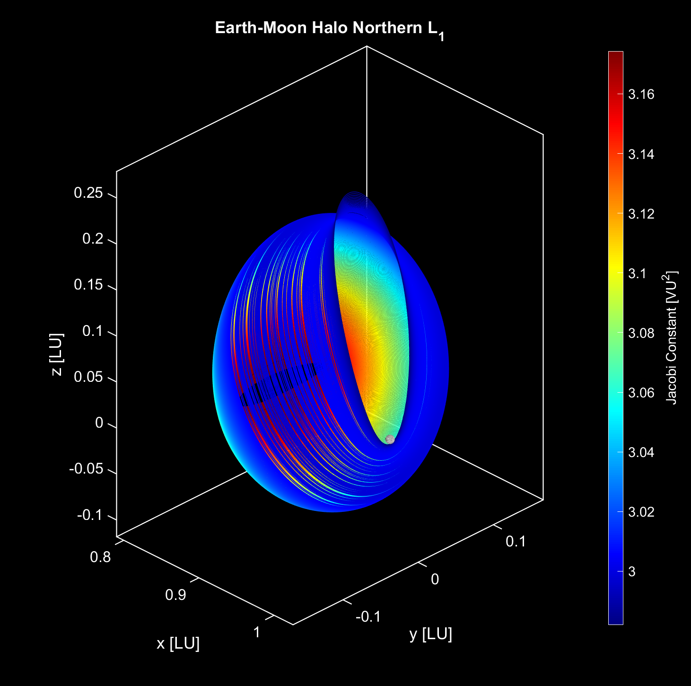

## Introduction
My Name is Kevin Isaac Alvarado

Currently I am a Ph.D. Candidate studying Aerospace Engineering and researcher for the Advanced Space Concepts Laboratory (ASCL) at Rensselaer Polytechnic Institute (RPI).

I graduated from Clarkson University with a Bachelor's Degree in Aerospace Engineering with Honors and am a McNair Scholar. Since then, I was part of the Astronautics and Robotics Laboratory (ASTRO Lab) at Clarkson University and part of various speed teams including Design Build Fly, RASC-AL and Concrete Canoe. Before attending Clarkson, I studied at a vocational school and became a certified Aircraft Maintenance Technician and was also a Product Service Engineering intern at General Electric Aviation.

Over the Summer of 2026 I also became a L'SPACE Alum, helping propose a NASA mission to study and improve solar sail and electric tethers technology for zero-propellant maneuvering in at $10000 competition.

My topics of research include: astrodynamics, trajectory design optimization, navigation & tracking, space domain awareness, mission architecture, and spacecraft systems.

Additional information Below:
Rensselaer Polytechnic Institute: https://meritpages.com/alvark

Current Lab (ASCL) at Rensselaer Polytechnic Institute:
https://www.asclabrpi.com

Clarkson University: https://meritpages.com/alvarakl

Former Lab (ASTRO Lab) at Clarkson University:
https://www.astrolabresearch.com/

## Related Work

Shown below are the Northern Halo Orbit families for the L1, L2, and L3 Lagrange Points in the Earth-Moon system.

Here are animations of various orbits within the Dragonfly Northern and Butterfly Northern Families respectively for the Earth-Moon system in the Circular Restricted Three-Body Problem.

Here is a simulation of a Distant Prograde Orbit (DPO) in the Sun-Earth-Moon system using the Bi-Circular Restricted Four-Body Problem without staion-keeping.

